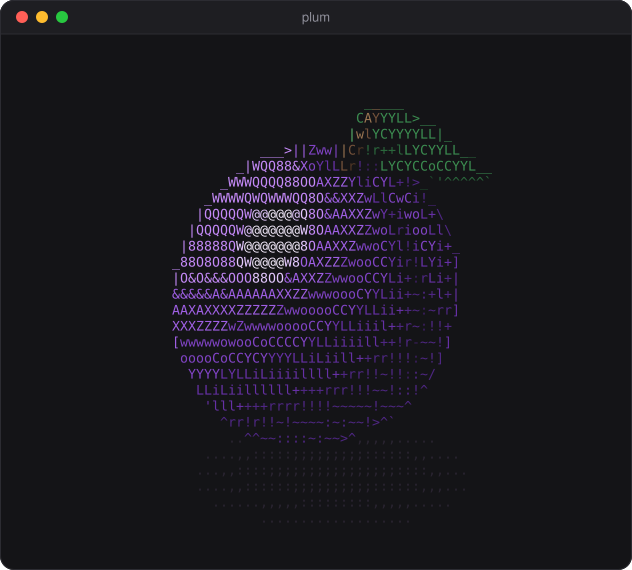

<div align="center">



<h1>Plum</h1>

<p><b>Ghostty보다 가볍고 빠른 터미널에, Orca 같은 에이전트 작업 공간.</b><br>
AI 코딩 에이전트 여러 개를 각자의 git worktree에서 나란히 돌리는 네이티브 macOS 앱.</p>

<p>
<a href="#설치"></a>
<a href="#설치"></a>
<a href="#빌드와-실행"></a>
<a href="LICENSE"></a>
<a href="#기여"></a>
</p>

<p>
<a href="#설치">설치</a> ·
<a href="#빌드와-실행">빌드</a> ·
<a href="#쓰는-법">쓰는 법</a> ·
<a href="#단축키">단축키</a> ·
<a href="#측정-결과">측정 결과</a> ·
<a href="#기여">기여</a> ·
<a href="README.md">English</a>
</p>

</div>

Orca처럼 프로젝트(git 저장소)를 등록하고 워크스페이스를 추가하면 브랜치와 worktree, 에이전트를 돌릴 터미널까지 한 창에 준비된다. 그러면서 터미널은 Ghostty보다 가볍고 빠르다. 같은 Mac에서 최신 Ghostty(1.4.0)와 번갈아 재 보면 메모리는 1/4(37MB 대 148MB), 키 입력이 화면에 나오기까지 18.5ms 대 24.0ms, 출력 처리는 7종류 모두 1.05~2.64배 빠르다([측정 결과](#측정-결과)).

<p align="center"></p>

상태: **0.1 (초기 공개판)**. 설계는 [`docs/superpowers/specs/2026-11-16-plum-design.md`](docs/superpowers/specs/2026-11-16-plum-design.md)에 있다. UI는 한국어와 영어로, 시스템 언어를 따르고 설정에서 바꿀 수 있다.

## 한눈에

- **Ghostty보다 가볍고 빠르다.** 메모리는 터미널 1개에 37MB, 10개에 49MB로 Ghostty의 1/4. 키 입력 지연 18.5ms(Ghostty 24.0ms), 출력 처리는 일반 텍스트 1.05배에서 색이 많은 화면 2.64배까지 7종류 모두 앞선다. 쉬는 동안 CPU는 30초에 1ms다.
- **워크스페이스마다 worktree 하나.** 새 워크스페이스를 만들면 브랜치와 worktree를 만들고, `.env` 같은 파일을 복사하고, 설정 명령을 돌린 뒤 첫 탭에서 Claude나 Codex를 띄운다.
- **에이전트 상태가 보이는 곳에.** 작업 중·입력 대기·완료·모니터링이 탭과 사이드바에 링으로 보이고, 손이 필요한 것은 맨 위로 모인다.
- **앱을 꺼도 살아 있는 터미널.** 껐다 켜도 셸, 에이전트, 개발 서버가 그대로 돌고 화면과 스크롤백이 돌아온다.
- **제대로 된 터미널.** 바탕은 libghostty-vt, 그리기는 Metal. 화면 분할, 찾기, 마우스 리포팅, OSC 8·52·133.
- **변경과 PR.** 커밋 안 한 변경이나 브랜치 전체의 diff, 사이드바의 PR 상태와 체크, PR 만들기까지.

## 설치

Homebrew로:

```sh
brew install --cask yeshyungseok/tap/plum
```

처음 쓰는 tap이라 Homebrew가 `brew trust yeshyungseok/tap`으로 신뢰할지 묻는다. 이 방법이면 처음 열 때도 macOS가 막지 않는다. 그 뒤 업데이트는 Plum이 직접 한다.

직접 받으려면: 릴리스 페이지에서 `Plum-<버전>-arm64.zip`을 받아 풀고, `Plum.app`을 응용 프로그램 폴더로 옮긴다. Apple Silicon Mac, macOS 14 이상에서 돈다.

아직 Apple 개발자 서명과 공증을 하지 않아서, 처음 열 때 macOS가 막는다. 한 번 열어 보고 막히면 시스템 설정 → 개인정보 보호 및 보안 맨 아래의 "그래도 열기"를 누르거나, 터미널에서 한 번 실행한다. 그 뒤의 업데이트는 Plum이 직접 내려받아 설치한다.

```sh
xattr -dr com.apple.quarantine /Applications/Plum.app
```

## 빌드와 실행

필요한 것: macOS 14 이상, Xcode. Apple Silicon Mac과 Xcode 16.4에서 빌드를 확인했다.

```sh
./scripts/build-vt.sh   # 처음 한 번. Zig 0.17.0과 libghostty-vt 1.0.1 소스를 받아 빌드한다(네트워크 필요)
./scripts/bundle.sh     # build/Plum.app 생성 (릴리스 빌드, ad-hoc 서명)
open build/Plum.app
swift test              # 자동 테스트
./scripts/release.sh    # 배포용 build/Plum-<버전>-<아키텍처>.zip, 업데이트 서명 .sig, SHA-256
```

릴리스에는 zip과 `.sig`를 함께 올린다. `.sig`는 업데이트 키(`~/.config/plum/update-signing-key`, `scripts/update-signing.swift`)로 만든다. 이 키를 잃으면 이미 배포된 앱은 그 뒤 릴리스를 스스로 설치하지 못하니 따로 백업해 둔다.

`build-vt.sh`는 Zig 압축 파일의 SHA-256을 확인하고, 내려받은 것은 `.tools/`에만 둔다(시스템에 설치하지 않는다).

## 쓰는 법

1. **프로젝트 추가**(⌘O): git 저장소 폴더를 고른다. 사이드바에 프로젝트와 `main`(원래 체크아웃)이 생긴다.
   - git 저장소가 아닌 폴더(저장소 여러 개를 모아 둔 폴더 등)는 "폴더로 열기"를 확인하면 폴더 프로젝트로 들어간다. Orca와 같다. 그 워크스페이스는 같은 폴더에서 여는 이름 붙은 탭 묶음이고, 워크트리·브랜치·변경·PR이 없으며, 지워도 폴더는 그대로다.
   - Orca를 쓰던 경우: 파일 → Orca에서 가져오기…(Orca가 켜져 있어야 함)로 거기서 쓰던 저장소와 워크트리를 Orca의 이름 그대로 더한다. Orca의 목록을 읽기만 하고 디스크는 바뀌지 않는다. 프로젝트가 없는 첫 실행에서 한 번 제안한다.
2. **프로젝트 설정**(프로젝트 이름 옆 ⋯): 워크스페이스를 만들 때 할 일을 정한다.
   - 복사할 파일: 기본 체크아웃에서 새 워크트리로 복사할 git 밖의 파일. 한 줄에 glob 하나. 예: `.env*`
   - 준비 명령: 예: `pnpm install`
3. **워크스페이스 추가**(⌘N 또는 프로젝트 옆 +): 팔레트에 이름을 치고, 첫 탭에서 시작할 것(기본은 터미널, 또는 Claude, Codex)을 고른 뒤 ↵. `<워크스페이스 위치>/<프로젝트>/<이름>`에 워크트리와 브랜치를 만들고, 파일을 복사하고, 첫 터미널 탭에서 `준비 명령 && 에이전트`를 실행한다.
   - 이름·폴더·브랜치가 겹치면 팔레트가 열린 채로 알려 준다.
   - 만드는 동안 사이드바에 행이 생기고 패널에 단계(원격 가져오기 → 워크트리 → 파일 복사)가 보인다. 그동안 다른 워크스페이스에서 일해도 된다.
4. **사이드바에서 보이는 것**: 워크스페이스마다 카드 하나.
   - 이름 아래에 브랜치, 커밋하지 않은 변경 줄 수(`+12 −3`, 새 파일 포함), PR 번호. PR은 `gh`가 설치·로그인돼 있을 때 GitHub에서 3분마다 가져온다. 색은 열림·초안·병합·닫힘, 옆 점은 검사 상태(진행 중·통과·실패). 누르면 브라우저로 연다.
   - 그 아래 탭마다 한 줄: 아이콘(터미널·Claude·Codex), 제목(에이전트는 탭에 붙인 대화 제목), 상태, 에이전트면 마지막 상태 변화 뒤 지난 시간, 탭의 프로그램이 연 포트(`:3000`, 누르면 브라우저). 줄을 누르면 그 탭으로 가고, 포인터를 올리면 ×로 닫는다. 탭은 4개까지 보이고, 나머지는 "탭 N개 더 보기"로 접힌다(그중 입력 대기가 있으면 그 줄에 표시).
   - 프로젝트 안에서는 카드를 끌어 순서를 바꾼다(`main`도 옮길 수 있다). 프로젝트 이름을 누르면 접히고, 접힌 동안에도 그 안의 에이전트 상태가 이름 옆에 보인다.
5. **이름 바꾸기와 정리**(워크스페이스 우클릭):
   - 이름 바꾸기(이름을 더블클릭해도 된다): 사이드바에 보이는 이름만 바뀌고 폴더와 브랜치는 그대로다.
   - 아카이브: 워크트리 폴더를 지우고 브랜치는 남긴다. 나중에 복원할 수 있다.
   - 삭제: 워크트리 폴더를 지우고, 로컬 브랜치는 그 작업이 기준 브랜치, 원격 기본 브랜치(먼저 가져온다), 기본 체크아웃 중 하나에 이미 들어 있을 때만(병합, squash, rebase) 지운다. Orca와 같다. 병합되지 않은 브랜치는 남기고, 그래도 지울지 원격에 없는 커밋과 함께 묻는다. 폴더 안쪽의 워크트리도 가장 깊은 것부터 함께 지운다.
   - 커밋하지 않은 변경, 폴더 안쪽의 워크트리, 함께 종료되는 프로그램이 있으면 목록으로 보여 주고 다시 확인한다. 이때 Return은 "취소"다.
   - 기본 체크아웃은 삭제할 수 없고, 메뉴에서 프로젝트를 Plum에서 제거할 수 있다.
   - 그 밖에: 읽음으로 표시(완료 표시 지우기), 탭 모두 닫기(워크트리는 두고 프로그램이 쓰던 메모리를 돌려받는다), 다른 앱에서 열기(설치된 VS Code·Cursor·Zed·Xcode·JetBrains·터미널·git 앱), PR 열기, 복사(경로·브랜치·PR 링크).
   - 프로젝트 이름 우클릭: 새 워크스페이스, 프로젝트 설정, 접기, Finder·다른 앱에서 열기, Plum에서 제거.
   - 탭 우클릭: 제목 변경(탭 제목을 더블클릭해도 된다. 비우면 프로그램 제목으로 돌아간다), 탭 닫기, 다른 탭 닫기, 오른쪽 탭 닫기.
   - 우클릭(또는 Control 클릭) 메뉴는 Plum의 자체 메뉴다. ↑↓로 고르고 Return으로 실행, →로 하위 메뉴(복사, 다른 앱에서 열기)를 펼치고 ←로 접는다. Esc나 바깥 클릭으로 닫는다.
6. **앱을 꺼도 터미널은 계속 돈다**: 터미널은 앱이 아니라 터미널 호스트(같은 실행 파일을 `--terminal-host`로 띄운 별도 프로세스)가 갖는다. 앱을 끄면(⌘Q) 셸, 에이전트, 개발 서버가 그대로 돌고, 다시 켜면 탭과 탭 순서, 화면과 스크롤백, 탭 제목(직접 붙인 것과 에이전트의 대화 제목), 열려 있던 탭, 그 사이 에이전트가 알린 상태(입력 대기·완료)가 돌아온다. 그래서 끌 때 묻지 않는다. 터미널이 하나도 없으면 호스트는 1분 뒤 스스로 끝난다.
   - 창의 빨간 버튼은 창만 숨긴다. Plum은 Dock에 남아 알림을 계속 받고, Dock 아이콘이나 알림을 누르면 창이 다시 열린다. 끝내려면 ⌘Q.
   - 프로그램이 실행 중인 탭을 닫을 때(⌘W)는 먼저 묻는다. 셸 프롬프트뿐인 탭은 바로 닫힌다.
   - 돌아오지 않는 것: Mac을 재시동하면 호스트도 끝나므로 터미널은 새로 열린다(에이전트 대화는 `claude --resume`, `codex resume`). vim처럼 전체 화면을 쓰는 프로그램이 떠 있으면 그 뒤의 셸 스크롤백은 돌아오지 않는다. 앱이 꺼진 동안의 벨과 알림은 전해지지 않는다(훅이 보낸 상태는 전해진다).
7. **링크**: 터미널의 http(s) 주소를 ⌘-클릭하면 브라우저로 연다.

### 단축키

워크스페이스와 탭 사이를 오가는 명령은 모두 "이동" 메뉴에 있다. 키는 [cmux](https://cmux.com/docs/keyboard-shortcuts)를 따르고, 마지막 칸의 키도 같은 명령으로 받는다.

| 명령 | 키 | 다른 키 |
|---|---|---|
| 워크스페이스로 이동… (이름으로 찾기, ↑↓ 고르기, ↵ 이동) | ⌘P | ⌘J |
| 다음 / 이전 워크스페이스 | ⌃⌘] / ⌃⌘[ | ⇧⌘↓ / ⇧⌘↑ |
| 워크스페이스 1~8 / 마지막 워크스페이스 | ⌘1~8 / ⌘9 | |
| 뒤로 / 앞으로 (다녀온 워크스페이스와 탭) | ⌘[ / ⌘] | ⌥⌘← / ⌥⌘→ |
| 직전 위치 (두 곳을 오가기) | 메뉴에서 | |
| 확인 필요로 이동 (입력 대기 먼저, 누를 때마다 다음) | ⇧⌘U | |
| 사이드바에서 고르기 (↑↓ 또는 j k, ↵·esc로 터미널로) | ⌃⌘E | ⇧⌘0 |
| 다음 / 이전 탭 | ⇧⌘] / ⇧⌘[ | ⌥⌘] / ⌥⌘[, ⌃PageDown / ⌃PageUp |
| 직전 탭 | ⌃Tab | ⌃Tab |
| 탭 1~8 / 마지막 탭 | ⌃1~8 / ⌃9 | |
| 워크스페이스를 위로 / 아래로 | ⌃⌥⌘[ / ⌃⌥⌘] | |
| 탭을 왼쪽으로 / 오른쪽으로 | ⌥⇧⌘[ / ⌥⇧⌘] | |

0.1 이전과 달라진 점: ⌘1~9가 탭이 아니라 워크스페이스를 고른다(cmux와 같게). 탭은 ⌃1~9다.

그 밖에: 새 워크스페이스 ⌘N, 새 탭 ⌘T(터미널. 탭 끝의 +와 파일 메뉴에서는 Claude·Codex 탭도 연다), 탭 닫기 ⌘W, 프로젝트 추가 ⌘O, 글자 크기 ⌘+ · ⌘- · ⌘0, 사이드바 너비는 경계를 끌어 조절(경계 더블클릭으로 기본 너비), 터미널의 줄 처음/끝 ⌘← · ⌘→, 단어 이동 ⌥← · ⌥→, 줄 지우기 ⌘⌫.

터미널에서:
- 찾기 ⌘F(지나간 출력까지, 영문 대소문자 무시). Return·⌘G는 위로(오래된 쪽), ⇧Return·⇧⌘G는 아래로, Esc로 닫는다. 찾은 곳이 선택되어 ⌘C로 복사된다.
- 화면 지우기 ⌘K(지나간 출력까지), 전체 선택 ⌘A(지나간 출력까지).
- 파일을 끌어다 놓으면 경로가 셸에 맞게 이스케이프되어 입력된다(스크린샷을 Claude Code에 붙일 때). 글을 끌어 놓으면 붙여넣기와 같다.
- 우클릭: 복사, 붙여넣기, 전체 선택, 찾기, 화면 지우기.
- 마우스를 원하는 프로그램(vim, htop, tmux)에는 클릭·끌기·휠을 그대로 전한다. ⇧를 누르고 하면 Plum이 받아 글을 선택한다. 마우스를 받지 않는 전체 화면 프로그램(less, git 페이저, man)에서는 휠이 ↑↓ 키가 된다.
- ⇧Return은 Esc Return으로 보내 Claude Code·Codex·zsh에서 "보내지 않고 줄바꿈"이 된다. Kitty 키보드 방식을 켠 프로그램에는 그 방식대로 보낸다.
- 설정의 "⌥를 Meta 키로 사용"을 켜면 ⌥B, ⌥. 같은 셸 단축키가 된다. 한글 입력 중에도 영문 키로 보낸다.
- ⌘T와 탭 끝 +의 터미널은 지금 탭의 셸이 있는 폴더에서 열린다(Claude·Codex 탭은 워크스페이스 맨 위에서).
- 닫은 탭 다시 열기 ⇧⌘T: 그 폴더에서 새 셸을 열고 붙인 제목을 되살린다. 그 안에서 돌던 프로그램은 돌아오지 않는다.
- 이전/다음 명령으로 ⌘↑ · ⌘↓: zsh 연동(설정, 기본 켬)이 프롬프트마다 표시(OSC 133)를 남긴다. Plum의 `.zshenv`가 먼저 읽혀 사용자의 ZDOTDIR을 되돌리고 사용자의 `.zshenv`를 읽은 뒤 표시용 훅만 더한다(Ghostty·VS Code와 같은 방식). 표시는 두 번째 프롬프트부터 남는다.
- 프로그램이 클립보드에 쓰는 것(OSC 52: vim의 `"+y`, tmux, ssh 너머)을 Mac 클립보드로 받는다. 글만 받고, 클립보드를 읽어 가는 요청은 받지 않는다.
- 프로그램이 건 링크(OSC 8: `ls --hyperlink`, gh 등)도 ⌘클릭으로 열린다. ⌘를 누른 채 링크 위에 있으면 손가락 포인터가 된다. 파일 링크는 열지 않고 Finder에서 보여 준다(여는 것만으로 실행될 수 있어서).
- 전체 화면 ⌃⌘F. 탭은 끌어서 다른 탭 위에 놓으면 그 자리로 옮겨진다.
- 화면 분할: 오른쪽으로 나누기 ⌘D, 아래로 나누기 ⇧⌘D(터미널 우클릭으로도). 새 창은 지금 창의 폴더에서 열리고 키보드를 받는다. 창 사이는 ⌘⌥←→↑↓나 클릭으로 옮기고, 사이의 선을 끌어 크기를 바꾼다. 키보드가 없는 창은 흐려진다. ⌘W는 키보드가 있는 창 하나를 닫는다. 탭 바에는 나눈 탭이 하나로 보이고(이름은 키보드가 있는 창의 것, 상태는 그 안에서 가장 급한 것), 사이드바에는 창마다 한 줄씩 보인다. 나눈 모양은 앱을 껐다 켜도 돌아온다.
- 새 창에서 열기 ⌥⌘N(워크스페이스 우클릭으로도): 워크스페이스를 사이드바 없는 따로 된 창으로 연다. 그 창이 앞에 있으면 메뉴와 단축키는 그 워크스페이스에 듣는다. 터미널은 한 곳에만 그려지므로 메인 창에서 그 워크스페이스를 고르면 "그 창으로 가기"가 보인다. 창을 닫으면 메인 창으로 돌아오고 터미널은 그대로다. 열어 둔 창은 다시 켤 때 다시 열린다.
- 설정: 커서 모양(블록·막대·밑줄)과 깜빡임, 탭마다 스크롤백 크기(MB), 강조 색(자두·파랑·초록·주황·분홍·흑연; 선택, 상태 줄, 커서에 쓰인다).

대화상자에서는 Return이 기본 버튼, Esc가 취소다. 대화상자가 열린 동안에는 메뉴 단축키가 뒤의 터미널에 닿지 않는다.

설정(⌘,):
- 언어: 시스템 언어(기본), 한국어, English. 바꾸면 다시 시작할지 묻고, 다시 시작해도 터미널은 그대로 이어진다.
- 글꼴: 설치된 고정폭 글꼴 목록에서 고른다. 한글이 섞인 미리보기로 바로 확인한다.
- 글꼴 크기: 8~40.
- 워크스페이스 위치: 기본 `~/plum/workspaces`. "선택…"으로 폴더를 고를 수 있고, `/`나 `~`로 시작하는 전체 경로만 받는다.
- 브랜치 접두사: 예 `dev/`. 저장할 때 git 브랜치 이름 규칙으로 검사한다.
- Claude 명령: 기본 `claude --settings "$PLUM_CLAUDE_SETTINGS"`. 이 설정 파일이 있어야 Claude가 작업 중·입력 대기·완료 상태를 알린다. Codex 명령: 기본 `codex`. 비우면 기본값으로 돌아간다.
- 권한: 세 가지 중에 고르고, 기본값은 "전체 허용"이다. 전체 허용은 Claude에 `--dangerously-skip-permissions`, Codex에 `--dangerously-bypass-approvals-and-sandbox`를 붙여 묻지 않고 모든 명령을 실행한다. 자동 승인은 `--permission-mode auto`와 `--approve-for-me`를 붙여 안전한 작업만 스스로 승인한다. 에이전트 자체 설정은 아무것도 붙이지 않는다. 명령에 권한 인수(`--permission-mode`, `-s`, `--yolo` 등)가 이미 있으면 그대로 둔다.
- 변경 보기 ⇧⌘E(사이드바의 +/− 숫자를 눌러도, 워크스페이스 우클릭으로도): 파일 목록과 줄 번호가 붙은 diff. "커밋 안 한 변경"과 "브랜치 전체"(기준 브랜치와 갈라진 곳부터, 커밋 안 한 것 포함)를 고른다. 새 파일도 보인다. 파일마다 3000줄까지 그린다.
- PR 만들기(변경 보기 화면, 워크스페이스 우클릭): 새 탭에서 `gh pr create --web`을 실행한다. 어디로 push할지는 gh가 그 탭에서 묻고, 끝나면 GitHub 양식이 브라우저에 열린다.
- 기존 워크트리: 프로젝트를 추가하면 그 저장소에 이미 있는 워크트리(직접 만들었거나 다른 도구가 만든 것)가 워크스페이스로 함께 들어온다. 나중에 생긴 것은 프로젝트 우클릭 → "기존 워크트리 가져오기". 디스크는 건드리지 않고, 브랜치 없는 워크트리는 뺀다.
- 업데이트: 켤 때와 켜 둔 동안 하루 한 번 GitHub 릴리스를 확인해, 새 버전이 있으면 오른쪽 아래 토스트로 알린다. Plum 메뉴 → "업데이트 확인…"으로 바로 확인한다. 토스트의 "설치"를 누르면 다시 묻지 않고 이 Mac용 zip을 내려받아, 함께 올린 Ed25519 서명(`.sig`)이 앱에 든 공개 키와 맞는지, 안의 앱이 그 버전의 Plum인지 확인한 뒤 한 번에 바꿔 끼우고 다시 연다. 터미널과 그 안의 프로그램은 그대로 이어진다. 서명이 맞지 않거나, macOS가 정한 임시 위치에서 돌고 있거나, 폴더를 바꿀 권한이 없으면 설치하지 않고 그 이유를 토스트로 알린다. 저장소가 비공개인 동안에는 확인할 릴리스가 없다고 나온다.
- 신뢰 기록(기본 켬): 에이전트 탭을 열기 전에 그 폴더를 Claude(`~/.claude.json`의 `hasTrustDialogAccepted`)와 Codex(`~/.codex/config.toml`의 `[projects."<폴더>"] trust_level = "trusted"`)에 신뢰한 폴더로 적는다. 새 워크트리에서 "이 폴더를 신뢰하나요?"에 멈추지 않는다. Claude 설정은 Claude의 잠금(`.claude.json.lock`)을 잡고 다시 읽은 뒤 파일 전체를 바꿔 넣는다. 설정 파일이 없거나 읽을 수 없으면 아무것도 쓰지 않는다. Codex에 이미 그 폴더 항목이 있으면 그대로 둔다.

마지막에 고른 워크스페이스는 다음에 열 때 다시 선택된다.

## 에이전트 상태

탭과 사이드바에 고리 하나로 표시한다: 상태 없음 = 흐린 고리, 작업 중 = 틈이 도는 고리(파랑), 모니터링 중 = 흐린 고리 안에 맥박선이 그려졌다 지워짐(청록), 입력 대기 = 숨 쉬는 두꺼운 고리(주황), 완료 = 체크를 새긴 채운 원(초록). 굵기·채움·안쪽 선·움직임이 달라 색을 구별하기 어려워도 알 수 있고, "동작 줄이기"를 켜면 움직이지 않는다. 모니터링 중은 Claude의 응답은 끝났지만 그가 띄운 백그라운드 작업(명령, Monitor, 예약된 깨우기)이 남아 있어 다시 깨어날 상태다(Stop 훅의 `background_tasks`·`session_crons`로 판단한다). 할 일이 없으므로 "확인 필요"에는 넣지 않는다. 입력 대기와 완료인 워크스페이스는 프로젝트와 상관없이 사이드바 맨 위 "확인 필요"에 모이고, 그 옆 칩에 입력 대기와 완료의 수가 따로 보인다. 보고 있지 않은 탭이 입력 대기나 완료가 되면 Dock 배지에 개수를 띄우고 Dock 아이콘을 한 번 튕긴다. macOS 알림으로 어느 워크스페이스인지도 알리고(누르면 그 탭이 열린다), 워크스페이스 PR의 소식(열림, 체크 통과·실패, 머지, 닫힘)도 알림으로 온다.

처음 알릴 일이 생기면 macOS가 Plum의 알림을 허용할지 한 번 묻는다. 그때 허용하지 않았다면 시스템 설정 → 알림 → Plum에서 켠다. 알림이 거부되면 Plum이 한 번 그렇게 안내한다. 임시 폴더에서 실행한 사본(`/private/tmp`에서 확인)은 알림을 보내지 못한다. macOS가 묻지 않고 거부한다.

선택 사항으로(설정, 기본은 꺼짐) 사이드바의 에이전트 탭 제목 아래에 모델을, 사이드바 맨 아래에 Claude와 Codex가 플랜의 세션(5시간)·주간 한도를 얼마나 썼는지 보여 준다. Claude Code는 둘 다 상태 표시줄 입력으로 알려 주므로, Plum이 Claude를 시작할 때 자기 상태 표시줄 명령을 넣어 그 입력을 Plum에 넘기고 이어서 사용자의 상태 표시줄 명령에 넘긴다. 표시줄은 여전히 사용자의 명령이 그린다. 설정을 켠 뒤 시작한 Claude 세션부터 적용되고, 한도는 구독 계정에서 첫 응답 뒤에만 나온다. Codex는 훅으로 알려 주지 않아서, Codex 탭의 상태가 바뀔 때 세션 파일(`sessions/…/rollout-*.jsonl`)을 읽는다. 메모리에 매핑한 파일의 끝에서부터 마지막 턴의 모델과 마지막 한도 기록 두 개만 찾는다(여기서 1.4MB 파일에 1.6ms). 파일은 폴더로 탭과 맞추므로, 같은 폴더의 Codex 탭 둘은 더 새로운 세션의 모델을 보여 준다. Plum은 로그인 정보를 읽지 않고 사용량 API도 부르지 않는다.

상태는 세 가지 경로로 들어온다.

| 경로 | 설정 | 비고 |
|---|---|---|
| Claude Code 훅 | `claude --settings "$PLUM_CLAUDE_SETTINGS"`로 실행 | 작업 중·입력 대기·완료를 모두 알린다. `~/.claude/settings.json`은 건드리지 않는다 |
| Codex 훅 | 없음. 처음 Codex 탭을 열 때 `~/.codex/hooks.json`(또는 `$CODEX_HOME`)에 Plum 터미널에서만 동작하는 훅을 덧붙인다 | 작업 중·입력 대기·완료를 알린다. Codex가 처음 한 번 묻는 대로 Codex 안에서 `/hooks`로 신뢰해야 동작한다. 원래 파일은 `hooks.json.pre-plum`에 남기고, 사용자의 훅은 자리와 내용 그대로 둔다 |
| OSC 7501 (프로그램 상태 표준) | 없음 | 이 표준을 지원하는 프로그램이면 자동 |
| OSC 9 / OSC 777 알림, 벨 | 없음 | 보고 있지 않은 탭에서만 "입력 대기"로 표시 |

Plum은 터미널마다 `PLUM_SOCKET`, `PLUM_TAB_ID`, `PLUM_CLAUDE_SETTINGS` 환경 변수를 넣는다. 훅은 macOS 기본 `nc`로 `<탭 ID> <working|waiting|done|idle>` 한 줄을 소켓에 보낸다. 다른 에이전트도 같은 한 줄을 보내면 연동된다.

## 저장 위치

- 앱 상태: `~/Library/Application Support/dev.plum.Plum/state.json`
- 훅 설정과 소켓: 같은 폴더의 `claude-hooks.json`, `plum.sock`
- 워크트리: 설정의 워크스페이스 위치 아래

## 확인한 것과 확인하지 못한 것

2026-11-16, MacBook Pro (M4 Pro, macOS 26.3.1)에서 확인했다.

**실행해서 확인한 것**

- 자동 테스트 15개 통과: 워크트리 생성(새 브랜치·기존 브랜치·한글 이름), 파일 복사와 저장소 밖 패턴 거부, 변경이 있는 워크트리는 강제 옵션 없이 지워지지 않음, 푸시 안 된 커밋 보고, 기본 체크아웃과 워크트리가 아닌 폴더는 지우지 않음, 앱 밖에서 지워진 폴더의 아카이브·복원, 상태 메시지 파싱, 상태 파일 손상 시 원본 보존.
- 실제 앱에서(테스트용 조작 소켓과 창 스크린샷으로): 프로젝트 등록 → 워크스페이스 생성 → `.env.local` 복사 → 준비 명령 실행, 아카이브·복원·삭제, 탭 열기·닫기·전환, 셸 종료 시 탭 닫힘과 좀비 프로세스 없음.
- 렌더링: 굵게·기울임·밑줄·취소선·반전·흐리게, 16색·256색·트루컬러, 한글 2칸 폭, 이모지(가족·국기 같은 묶음 포함), 파워라인 프롬프트, vim 전체 화면, Claude Code의 폴더 신뢰 확인 화면.
- 키 입력 인코딩(`cat -v`로 확인): 일반 글자, 방향키, Enter, Esc, Ctrl+A, Ctrl+C, Shift+Tab, ⌥←, ⌘←.
- 에이전트 상태: 소켓 메시지, OSC 7501, 벨이 사이드바에 반영됨. 잘못된 메시지와 모르는 탭 ID는 무시됨. 소켓 파일 권한 0600.
- 보이지 않는 창은 그리지 않는 규칙: 화면에 보이는 상태로 실행하면 터미널이 그려지고, 창을 최소화한 동안 나온 출력이 창을 되돌린 뒤 화면에 나타남.
- 실제 Claude Code 2.1.325: `claude --settings "$PLUM_CLAUDE_SETTINGS" -p …` 한 번 실행에서 대기 → 작업 중 → 완료 → 대기로 바뀜.

**2026-11-17 UI 개편에서 실행해서 확인한 것**

- 대화상자: 시스템 시트(`beginSheet`)는 열고 닫을 때마다 자체 이벤트 루프로 메인 스레드를 약 0.3초 붙잡아, 그동안 터미널 출력과 화면 갱신이 멈췄다. 창 안 오버레이와 Core Animation 전환으로 바꿨다. 탭 제목이 초당 10번 바뀌는 부하에서 잰 메인 스레드 최장 정지는 아래와 같다(`debug hitches`, 각 5회 열고 닫기).

  | | 바꾸기 전 | 바꾼 뒤 |
  |---|---|---|
  | 새 워크스페이스 팔레트 | 354ms | 52ms (열 때 한 번, 뷰를 만드는 비용. 움직임은 그 뒤 시작) |
  | 설정 | 331ms | 40ms (같음) |
  | 삭제 확인 | 316ms | 18ms |
  | 오류 토스트 | 20ms | 31ms (원래 문제 없었음. 미끄러져 들어오는 움직임이 더해짐) |
  | 아무것도 안 할 때, 120Hz 한 프레임(8.3ms)을 넘긴 횟수 / 14초 | 80 | 15 |

- 모델을 Observation으로 바꿔, 탭 제목이 바뀌면 탭 바만 다시 그린다(전에는 사이드바까지 전부).
- 키보드: 팔레트는 열자마자 이름 칸에 커서, 이름을 치고 Return이면 생성. 확인 창의 Return(파괴적이면 "취소")과 Esc, 닫은 뒤 키보드가 터미널로 돌아옴, 대화상자가 열린 동안 메뉴 단축키가 터미널에 닿지 않음.
- 종료 확인: ⌘Q는 앱 안에서 묻고, Esc면 남고 Return이면 끝난다. 로그아웃·재시동 때는 macOS가 먼저 묻기 때문에 다시 묻지 않는다.
- 실행 중 프로그램 감지(`sleep` 실행 중 ⌘W → 확인, 프롬프트에서는 바로 닫힘), 다시 열었을 때 마지막 선택 복원, 글꼴 목록과 이름 해석, 한글과 줄바꿈이 섞인 줄에서 링크 찾기(자동 테스트).
- 링크와 붙여넣기: 실제 마우스 이벤트로 ⌘-클릭하면 링크를 열고(디버그 모드는 브라우저 대신 기록), bracketed paste가 꺼진 프로그램(`cat`)에 여러 줄을 붙이면 묻는다. zsh처럼 켜 둔 셸에는 묻지 않고 붙인다. 디버그 모드는 별도 클립보드를 써서 사용자 클립보드를 건드리지 않는다.
- 이동 명령: 위 표의 키를 모두 실제 키 이벤트 경로(`NSApp.sendEvent`)로 보내 확인했다. 이 과정에서 ⇧⌘[ · ⇧⌘]가 0.1에서 동작하지 않던 것을 찾아 고쳤다(⇧가 만든 `{` `}`로 등록해야 맞는다). 뒤로·앞으로, 번호, 순서 옮기기, 찾기 순위는 자동 테스트도 있다.
- 영어 UI(`-AppleLanguages "(en)"`)와 hardened runtime 서명(`PLUM_SIGN_IDENTITY=-`)에서 셸·렌더링·워크트리 생성.
- 워크스페이스 전환 직후의 화면: 전환하고 0초·0.05초·0.35초 뒤에 터미널 영역을 캡처해 기준 화면과 비교, 70회 모두 새 워크스페이스가 그려져 있었다(한 번 본 직전 화면은 재현되지 않음).
- 한글 입력기 경로: 입력기가 부르는 순서 그대로 `setMarkedText`(ㅎ→하→한, ㄱ→그→글)와 `insertText`를 불러, 조합 중에는 셸로 아무것도 가지 않고 확정한 `한글`만 들어가는 것.
- 마우스(실제 마우스 이벤트 경로): 더블클릭은 단어, 트리플클릭은 줄, 드래그는 그 범위, 클릭은 선택 해제. 휠 스크롤(이전 줄이 보이고, 되돌리면 처음 화면, 스크롤한 채 입력하면 맨 아래로).
- Dock 배지: 보이지 않는 탭이 입력 대기·완료가 되면 Dock 배지가 1, 2로 올라간다.

**2026-11-19 사이드바 확장에서 실행해서 확인한 것**

- 자동 테스트 40개 통과(측정용 3개 건너뜀). 새로 넣은 것: 변경 줄 수(수정, 새 텍스트 파일, 바이너리·무시 파일 제외, 커밋 없는 저장소), PR 목록 해석(브랜치마다 최신 하나, 포크의 같은 이름 브랜치 제외, 검사 상태 합치기), 접은 프로젝트가 ⌘1~9 순서에서 빠지고 저장됨, 여러 칸 이동, 탭 제목, 탭에서 연 포트 감지와 사라짐, 셸이 앱의 파일 디스크립터를 물려받지 않음.
- 테스트 앱에서(합성 마우스 이벤트): 탭 줄·이름 줄·브랜치 줄 클릭, 이름 더블클릭으로 이름 바꾸기, 카드 끌어 순서 바꾸기(저장까지, `main` 포함, 높이가 다른 카드로 연속 네 번), 프로젝트 접기, 자체 우클릭·Control 클릭 메뉴(워크스페이스·프로젝트·기본 체크아웃·탭, 하위 메뉴 펼치기, Esc), 탭 제목 더블클릭으로 바꾸기(창 크기·위치 그대로), 에이전트 탭의 권한 플래그와 신뢰 기록(임시 설정 폴더), 탭 제목 변경 뒤 키보드가 터미널로 돌아옴, `python3 -m http.server`의 포트 표시, 에이전트가 끝나면 그 줄이 사라짐.
- 고친 버그(전부터 있던 것): 새 셸이 앱이 연 파일 디스크립터(상태 소켓, 다른 탭의 pty, 실행 중인 git의 출력 파이프)를 모두 물려받았다. git 실행과 새 탭 열기가 겹치면 셸이 파이프를 쥐고 있어 앱이 git 출력을 영원히 기다렸다. 이제 셸에는 터미널만 넘긴다.
- 실제 GitHub 데이터: 공개 저장소 `cli/cli`를 얕게 복제해, 실제 PR과 같은 이름의 브랜치로 기본 체크아웃과 워크스페이스 두 개를 만들었다. 배지가 `gh` 원본과 같게 나왔다(#15100 열림·검사 통과, #15081 병합·통과, #15095 열림·통과). 프로젝트를 추가하면 다음 3분을 기다리지 않고 바로 가져온다.
- 대기 부하: 탭 8개를 연 테스트 앱이 30초 동안 CPU 50ms. 변경 줄 수는 그 사이 출력이 있었던 워크스페이스만 30초마다 다시 센다.

**2026-11-19 앱을 꺼도 터미널 유지(터미널 호스트)에서 확인한 것**

- 자동 테스트 44개 통과(측정용 3개 건너뜀). 새로 넣은 것: 앱 없이 셸이 계속 돌고 다시 붙으면 이전 화면, 떨어져 있는 동안의 출력, 그 사이 바뀐 창 제목이 돌아옴(같은 셸 pid, 입력도 다시 전달), 앱이 화면을 넘기지 못하고 사라져도(비정상 종료) 최근 출력으로 복구, 앱이 꺼진 동안 훅이 보낸 상태는 남고 앱이 이미 확인한 상태는 지워짐, 탭을 닫으면 셸이 끝남, 없는 터미널에는 붙지 않음.
- 테스트 앱에서 끄고 다시 켜기: 꺼진 동안 호스트(부모가 launchd로 바뀜), 가짜 Claude, `python3 -m http.server`가 계속 돌았고 서버는 응답했다(200). 다시 켜자 워크스페이스별 탭 수·순서·열린 탭, 화면 내용, 직접 붙인 탭 제목("웹 서버"), Claude 대화 제목, 포트, 마지막 선택이 그대로였고, 꺼진 동안 훅이 보낸 "입력 대기"가 사이드바와 "확인 필요"에 보였다. 터미널이 모두 끝나자 호스트는 스스로 종료하고 소켓을 지웠다.
- 비용: 호스트는 탭 7개가 붙어 있을 때 메모리 4MB, CPU 0%. 앱이 붙어 있는 동안 호스트는 출력을 해석하지 않고 넘기기만 한다(앱이 꺼진 뒤에만 해석한다). 대량 출력(50MB 텍스트, 릴리스 빌드, 6회 중앙값)은 직접 pty 183MB/s, 호스트 경유 152MB/s(0.83배). pty가 1KB씩 넘기는 출력마다 소켓 쓰기·읽기가 더해지기 때문이다. pty를 앱에 직접 넘기면 빨라지지만, 앱이 꺼지는 순간 들어온 출력이 사라질 수 있어 택하지 않았다.

**확인하지 못한 것 — 직접 써 보며 확인이 필요하다**

- **실제 Claude·Codex를 띄운 채 끄고 켜기**: 가짜 프로세스와 훅 명령으로 확인했다.

- **사이드바를 실제 마우스로**: 카드 끌기, 탭 줄의 ×, 포트·PR 클릭은 합성 이벤트로만 확인했다.
- **실제 Claude·Codex 탭의 제목**: 이름이 `claude`·`codex`인 가짜 프로세스로 확인했다. Codex가 탭 제목을 붙이지 않으면 "Codex"로만 보인다. npm으로 설치해 프로세스 이름이 `node`이면 에이전트로 알아보지 못한다.

- **전환 효과의 체감**: 배경 창에서 측정과 캡처로 확인했다. 120Hz 화면 앞에서 눈으로 본 확인은 아니다.
- **Developer ID 서명과 공증**: 인증서가 없어 `release.sh`의 그 단계는 실행해 보지 못했다(ad-hoc + hardened runtime까지만 확인).
- **실제 릴리스로 하는 업데이트 (2026-11-23)**: 테스트 앱에서 서명한 0.2.0 zip을 같은 설치 경로로 넣어, 변조한 파일과 버전이 다른 파일은 거부하고, 맞는 파일은 바꿔 끼운 뒤 다시 열리며 터미널과 그 안의 `sleep`이 이어지는 것을 확인했다. GitHub에서 내려받는 부분과, 응용 프로그램 폴더에 있는 앱을 바꿀 때 macOS가 "앱 관리" 권한을 묻는지는 확인하지 못했다.
- **한글 입력(IME)을 실제 키보드로**: 입력기가 부르는 메서드는 확인했지만(위), 실제 macOS 입력기를 거친 입력은 아니다. 특히 조합 중 Enter는 입력기가 처리하는 부분이라 확인하지 못했다.
- **실제 키보드와 마우스**: 키와 클릭은 모두 합성 이벤트를 앱의 실제 경로(`NSApp.sendEvent`)로 보내 확인했다. 사람이 키보드·트랙패드로 해 본 확인은 아니다.
- **macOS 알림 (2026-11-24)**: Apple 인증서 없이 만든 빌드에는 macOS가 알림을 거부한다는 2026-11-20의 결론은 틀렸다. 테스트 앱을 임시 폴더에서 실행했는데, 거기서는 macOS가 묻지 않고 거부한다("이 앱에는 알림이 허용되지 않음"). 일반 폴더에서는 ad-hoc 빌드도 다른 앱처럼 허용할지 묻는다. 0.1.4 사본을 번들 ID만 바꿔 `build/`에서 실행하자 macOS가 물었고, 허용하자 완료 알림이 알림 센터에 들어갔다(시스템 로그). 이 문제를 찾은 Mac에서는 Plum의 알림 권한이 거부로 저장되어 있어서 알림이 한 번도 뜨지 않았던 것이다. 0.1.5는 예전 방식(NSUserNotification)으로만 보냈는데, 지금 방식을 쓴 적 있는 앱에는 usernoted가 예전 방식을 거부하므로("You can't mix modern clients with legacy clients") 알림을 허용해 둔 사용자의 알림까지 끊었다. 0.1.6은 지금 방식만 쓴다. `build/`의 사본으로 확인한 것: 허용된 ID에서는 알림이 저장되고, 거부된 Plum 자신의 ID에서는 안내가 한 번 뜨고 두 번째에는 뜨지 않는다. 확인하지 못한 것: 배너를 눈으로 보는 것, 알림을 눌렀을 때, PR 소식 알림(자동 테스트로만 확인).
- **Claude Code 대화형 화면**: 권한 요청 시 "입력 대기"로 바뀌는지는 확인하지 못했다. 신뢰 기록은 테스트와 실제 `~/.claude.json`의 사본(추가한 키 말고는 내용이 같음)으로만 확인했고, 실제 Claude·Codex를 띄워 신뢰 확인 화면이 사라지는지는 보지 않았다.
- **Codex 연동**: 구현도 확인도 하지 않았다.

## 측정 결과

메모리, 키 입력 지연, 출력 처리 모두 최신 Ghostty(1.4.0)보다 앞선다. 같은 Mac(M4 Pro, 외장 75Hz 화면)에서 두 앱을 번갈아 쟀다.

**출력 처리 (2026-11-23).** 같은 데이터를 두 앱에 번갈아 보내고, 차례마다 그 앱을 맨 앞에 두어 둘 다 그리게 했다. 종류마다 6라운드를 돌려 라운드별 비율의 중앙값을 냈다.

| 데이터 | Plum ÷ Ghostty 1.4.0 |
|---|---|
| 색이 많은 화면 (dense_cells) | **2.64배** |
| 유니코드 (unicode) | **1.42배** |
| 스크롤 (scrolling) | **1.32배** |
| 커서 이동 (cursor_motion) | **1.29배** |
| TUI 다시 그리기 (sync_tui) | **1.17배** |
| 스크롤 영역 (scroll_region) | **1.07배** (다시 재서 1.13배) |
| 일반 텍스트 (ascii) | **1.05배** (다시 재서 1.09배) |

**메모리, 지연, 실행 (2026-11-17, 중앙값).**

| 항목 | Plum | Ghostty 1.4.0 | 표본 |
|---|---|---|---|
| 메모리, 터미널 1개, 보이는 유휴 상태 | **37MB** | 148MB | 각 4회 |
| 메모리, 터미널 10개 | **49MB** | 214MB | 각 5회 |
| 키 입력 → 화면 표시 | **18.5ms** | 24.0ms | 각 400회 |
| 유휴 CPU (30초) | **1ms** | 107ms | 각 4회 |
| 실행 → 창이 뜸 | **284ms** | 346ms | 각 15회 |
| 실행 → 셸 시작 | 243ms | 226ms | 각 15회 |
| 앱 크기 | **3.0MB** | 67MB | |

- 셸이 시작되기까지는 Ghostty가 17ms 빠르다.
- 키 입력 지연에는 키보드와 패널의 응답 시간이 들어 있지 않다.
- 한 대의 Mac에서 잰 값이다. 라운드별 값과 평균, 측정 방법, 한계는 [`docs/benchmarks/2026-11-20.md`](docs/benchmarks/2026-11-20.md)(출력 처리와 그사이의 최적화, 메모리가 어디에 쓰이는지)와 [`docs/benchmarks/2026-11-17.md`](docs/benchmarks/2026-11-17.md)(표본 수, 흩어짐)에 있다.
- 지난 측정(Ghostty 1.3.1과 비교)은 [`docs/benchmarks/2026-11-16.md`](docs/benchmarks/2026-11-16.md)에 있다.

다시 재려면: `swiftc -O bench/plumbench.swift -o bench/plumbench && python3 bench/run.py all` (약 50분, 측정 창이 포커스를 가져간다). 비교할 Ghostty는 `PLUM_BENCH_GHOSTTY`로 정한다(자세히는 측정 문서).

## 아직 없는 것

밝은 테마(만들었다가 뺐다), 한국어·영어 밖의 UI 언어, bash·fish의 프롬프트 표시, 서명·공증된 배포판(`release.sh`는 준비됨, Developer ID 인증서가 필요하다), Intel Mac 빌드. 이유와 순서는 설계 문서 14장에 있다.

## 코드 구조

```
Sources/CPty/                  pty 생성 (forkpty + execve)
Sources/PlumKit/Terminal/      TerminalSession(pty·VT 상태), TerminalRenderer·GlyphAtlas(Metal), TerminalView(입력), KeyMap
Sources/PlumKit/Model/         Models·Store, Git, WorkspaceService, StatusServer, AppModel, DebugCommands
Sources/PlumKit/UI/            App(메뉴·알림·종료 확인), MainWindow(창·탭 바·대화상자 표시), Sidebar,
                               Sheets(대화상자 내용), AppActions(확인이 필요한 동작), Controls(버튼·상태 표시·토스트), Theme
Sources/Plum/                  진입점
Vendor/                        libghostty-vt xcframework (build-vt.sh가 생성, git에는 넣지 않음)
scripts/                       build-vt.sh, bundle.sh, release.sh, update-signing.swift(업데이트 서명 키와 서명). readme-bench.py는 README의 비교 그래프(docs/assets/bench*.svg)를, readme-plum.py는 README 맨 위 자두(docs/assets/plum.svg)와 아이콘용 작은 자두(icon/AsciiPlumFrames.swift)를 그리고, make-icon.sh는 그것으로 앱 아이콘을 만든다
```

VT 해석과 화면 상태는 [libghostty-vt](https://libghostty.tip.ghostty.org/) 1.0.1(MIT)에 맡기고, 렌더러·글꼴·입력·pty는 직접 만들었다. 외부 의존성은 이것 하나다.

### 스크립트로 앱 조작하기

`PLUM_DEBUG=1`로 실행하면 상태 소켓이 `debug …` 명령도 받는다. 위의 확인은 이 방법으로 했다. `PLUM_STATE_DIR`로 상태 폴더를 바꾸면 실제 상태를 건드리지 않는다.

```sh
PLUM_DEBUG=1 PLUM_STATE_DIR=/tmp/plum-dev build/Plum.app/Contents/MacOS/Plum &
printf 'debug state\n' | nc -w 3 -U /tmp/plum-dev/plum.sock
```

명령 목록은 `Sources/PlumKit/Model/DebugCommands.swift`에 있다. UI를 바꿀 때 쓸 만한 것:

- `debug hitches start` … `debug hitches stop`: 그 사이 메인 스레드가 한 프레임(8.3ms) 넘게 멈춘 횟수와 가장 긴 시간.
- `debug sheet new|<프로젝트>`, `settings`, `delete|<워크스페이스>`, `close`: 대화상자 열고 닫기.
- `debug keywin <키 코드>|<문자>[|<수정 키>]`: 실제 키 입력과 같은 경로로 키 보내기. `debug responder`: 지금 키보드를 가진 뷰.
- 디버그 실행은 종료 확인을 건너뛴다. 확인하려면 `PLUM_DEBUG_ASK_QUIT=1`을 함께 준다.

UI 문자열: 소스의 한국어가 키이고 영어는 `Resources/en.lproj/Localizable.strings`에 있다. 키 목록은 컴파일러가 뽑아 준다: `swift build -Xswiftc -emit-localized-strings -Xswiftc -emit-localized-strings-path -Xswiftc <폴더>`.

스크립트로 띄운 인스턴스는 `PLUM_DEBUG=1`이어도 창을 뒤로 보내고 앱을 앞으로 가져오지 않는다. 같은 Mac에서 일하는 중이어도 방해하지 않도록 하기 위해서다.

## 기여

기여를 환영합니다. 버그 제보, 아이디어, 문서, 코드 모두 좋습니다.

- **버그와 아이디어**: 이슈로 남겨 주세요. 버그라면 무엇을 했고, 무엇을 기대했고, 실제로 어떻게 됐는지와 macOS 버전을 적어 주세요.
- **풀 리퀘스트**: 작고 한 가지에 집중한 PR이 리뷰하기 쉽습니다. 먼저 `swift test`를 돌리고, 화면을 바꿨다면 위의 방법으로 띄워 확인해 주세요. 큰 변경은 이슈에서 방향을 먼저 맞추면 좋습니다.
- **방향**: Plum이 무엇을 하려는지, 무엇을 일부러 넣지 않는지는 설계 문서 3·4장에 있습니다.

## 라이선스

MIT, [`LICENSE`](LICENSE). 터미널 해석에 쓰는 libghostty-vt도 MIT이며, 고지는 [`Vendor/LICENSE-ghostty`](Vendor/LICENSE-ghostty)와 앱 안 `Contents/Resources/LICENSE-ghostty.txt`에 있다.

에이전트 선택에 보이는 Claude와 OpenAI 로고는 Anthropic과 OpenAI의 상표다. 모양은 [Simple Icons](https://simpleicons.org)(CC0)에서 가져왔다.
