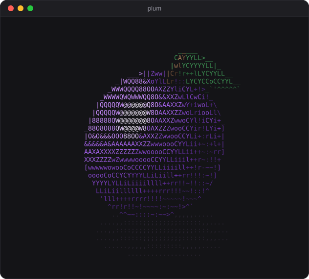

<div align="center">



<h1>Plum</h1>

<p><b>A terminal lighter and faster than Ghostty, with an agent workspace as handy as Orca.</b><br>
A native macOS app for AI coding agents side by side, each in a git worktree of its own.</p>

<p>
<a href="#install"></a>
<a href="#install"></a>
<a href="#build-and-run"></a>
<a href="LICENSE"></a>
<a href="#contributing"></a>
</p>

<p>
<a href="#install">Install</a> ·
<a href="#build-and-run">Build</a> ·
<a href="#using-it">Using it</a> ·
<a href="#keyboard">Keyboard</a> ·
<a href="#performance">Performance</a> ·
<a href="#contributing">Contributing</a> ·
<a href="README.ko.md">한국어</a>
</p>

</div>

As in Orca, add a project (a git repository), add a workspace, and Plum makes the branch, the worktree and a terminal for your agent, all in one window. And the terminal is lighter and faster than Ghostty: measured against the latest Ghostty (1.4.0) on the same Mac, taking turns, it uses a quarter of the memory (37 MB against 148 MB), puts a key press on screen in 18.5 ms against 24.0 ms, and handles all seven kinds of output 1.05-2.64x faster ([Performance](#performance)).

<p align="center"></p>

Status: **0.1 (first public release)**. The design (in Korean) is in [`docs/superpowers/specs/2026-11-16-plum-design.md`](docs/superpowers/specs/2026-11-16-plum-design.md). The UI is in English and Korean, following the system language.

## At a glance

- **Lighter and faster than Ghostty.** 37 MB of memory with one terminal and 49 MB with ten, a quarter of Ghostty's. 18.5 ms from key press to screen (Ghostty 24.0 ms), and ahead on all seven kinds of output, from 1.05x for plain text to 2.64x for dense colors. 1 ms of CPU per 30 s while idle.
- **A worktree per workspace.** A new workspace gets a branch and a worktree, your `.env` files copied in, the setup command, then Claude or Codex in its first tab.
- **Agents' state where you look.** Working, waiting, done and monitoring show as rings on tabs and in the sidebar; whatever needs you gathers at the top.
- **Terminals that outlive the app.** Quit and start again: shells, agents and dev servers keep running, and screens and scrollback come back.
- **A real terminal.** libghostty-vt underneath, drawn with Metal. Split panes, find, mouse reporting, OSC 8, 52 and 133.
- **Changes and pull requests.** A diff of uncommitted work or the whole branch, PR state and checks in the sidebar, Create PR in one step.

## Install

Download `Plum-<version>-arm64.zip` from the releases page, unzip it and move `Plum.app` to Applications. It runs on Apple Silicon Macs with macOS 14 or later.

The app isn't signed with an Apple Developer ID or notarized yet, so macOS blocks it the first time. Try opening it once, then click "Open Anyway" at the bottom of System Settings → Privacy & Security, or run once:

```sh
xattr -dr com.apple.quarantine /Applications/Plum.app
```

Later updates Plum downloads and installs itself.

## Build and run

You need macOS 14 or later and Xcode. Builds are checked on an Apple Silicon Mac with Xcode 16.4.

```sh
./scripts/build-vt.sh   # once: downloads Zig 0.17.0 and libghostty-vt 1.0.1 and builds it (needs the network)
./scripts/bundle.sh     # makes build/Plum.app (release build, ad-hoc signature)
open build/Plum.app
swift test              # automated tests
./scripts/release.sh    # build/Plum-<version>-<arch>.zip, its update signature .sig, and its SHA-256
```

`build-vt.sh` checks the Zig archive's SHA-256 and keeps what it downloads in `.tools/` (nothing is installed system-wide).

Upload the zip and its `.sig` to the release. The `.sig` is made with the update key (`~/.config/plum/update-signing-key`, `scripts/update-signing.swift`); keep a backup, since copies already out install later releases only with it.

To ship a build macOS opens directly, `release.sh` signs with the hardened runtime and notarizes when given `PLUM_SIGN_IDENTITY="Developer ID Application: …"` and `PLUM_NOTARY_PROFILE=<notarytool profile>`.

## Using it

1. **Add a project** (⌘O): choose a git repository folder. The sidebar shows the project and `main`, its original checkout.
2. **Project settings** (the ⋯ next to a project name): what happens when a workspace is made.
   - Files to copy: files outside git (one glob per line, e.g. `.env*`) copied from the main checkout into each new worktree.
   - Setup command, e.g. `pnpm install`.
3. **Add a workspace** (⌘N or the + next to a project): type a name in the palette, choose what the first tab starts (Terminal, Claude or Codex; the last choice is kept) and press Return. Plum makes a worktree and a branch at `<workspace location>/<project>/<name>`, copies the files, and runs `setup command && agent` in the first terminal tab.
   - A name, folder or branch that's taken is reported while the palette is still open.
   - While it's being made, a row shows in the sidebar and the panel lists the steps (fetch, worktree, copy files). You can keep working in other workspaces meanwhile.
4. **What the sidebar shows**: one card per workspace.
   - Under the name: the branch, uncommitted changed lines (`+12 −3`, new files included) and the pull request. Pull requests come from GitHub every 3 minutes when `gh` is installed and signed in; the color is open, draft, merged or closed, the dot the checks (running, passing, failing). A click opens it.
   - Then a line per tab: icon (terminal, Claude, Codex), title (for an agent, the conversation title it gives its tab), state, for an agent the time since its state last changed, and ports its programs listen on (`:3000`, a click opens the browser). A click on the line shows that tab; under the pointer, × closes it. Up to four tabs show; the rest fold into a "Show N more tabs" line, which carries the state of any that needs you.
   - Drag cards to reorder them within a project, `main` included. Click a project's name to fold it; folded, it still shows its agents' state.
5. **Rename and clean up** (right-click a workspace):
   - Rename (or double-click its name): changes only the name shown in the sidebar; the folder and branch stay.
   - Archive: removes the worktree folder and keeps the branch, so it can be restored later.
   - Delete: removes the worktree folder and the local branch.
   - Uncommitted changes, commits on no remote and programs that would be ended are listed first. Return means Cancel there.
   - The main checkout can't be deleted; its menu offers removing the project from Plum instead.
   - Also: Mark as Read, Close All Tabs (keeps the worktree, frees what its programs held), Open In (the editors, terminals and git apps installed), Open PR, Copy (path, branch, PR link).
   - Right-click a project's name: New Workspace, Project Settings, Collapse, Show in Finder, Open In, Remove from Plum.
   - Right-click a tab: Rename Tab (or double-click its title; empty gives back the program's title), Close Tab, Close Other Tabs, Close Tabs to the Right.
   - Right-click (or Control-click) menus are Plum's own: ↑↓ to pick, Return to run, → to open a submenu (Copy, Open In) and ← to close it, Esc or a click outside to dismiss.
6. **Terminals outlive the app**: a separate terminal host process (the same executable with `--terminal-host`) owns them. Quit (⌘Q, or close the window) and shells, agents and dev servers keep running; start Plum again and tabs come back in their order, with their screen and scrollback, titles (yours and the agents' conversation titles), which one was open, and agent states reported meanwhile (waiting, done). So quitting doesn't ask. With no terminals left, the host ends itself after a minute.
   - Closing a tab with a program running in it (⌘W) asks first; a tab at a shell prompt closes right away.
   - Not brought back: terminals after a restart of the Mac (the host ends too; resume agent conversations with `claude --resume` or `codex resume`), the shell scrollback behind a full-screen program such as vim, bells and notifications while Plum was closed (hook states are kept).
7. **Links**: ⌘-click an http(s) address in the terminal to open it.

### Keyboard

Every command for moving between workspaces and tabs is in the Go menu. The keys follow [cmux](https://cmux.com/docs/keyboard-shortcuts); the keys in the last column do the same thing.

| Command | Key | Also |
|---|---|---|
| Go to Workspace… (type to find, ↑↓ to pick, Return to go) | ⌘P | ⌘J |
| Next / previous workspace | ⌃⌘] / ⌃⌘[ | ⇧⌘↓ / ⇧⌘↑ |
| Workspace 1–8 / last workspace | ⌘1–8 / ⌘9 | |
| Back / forward (through workspaces and tabs visited) | ⌘[ / ⌘] | ⌥⌘← / ⌥⌘→ |
| Last place (switch between two) | in the menu | |
| Go to Needs Attention (waiting first; again for the next) | ⇧⌘U | |
| Pick in Sidebar (↑↓ or j k; Return or Esc back to the terminal) | ⌃⌘E | ⇧⌘0 |
| Next / previous tab | ⇧⌘] / ⇧⌘[ | ⌥⌘] / ⌥⌘[, ⌃PageDown / ⌃PageUp |
| Previously used tab | ⌃Tab | ⌃Tab |
| Tab 1–8 / last tab | ⌃1–8 / ⌃9 | |
| Move workspace up / down | ⌃⌥⌘[ / ⌃⌥⌘] | |
| Move tab left / right | ⌥⇧⌘[ / ⌥⇧⌘] | |

Changed since before 0.1: ⌘1–9 picks a workspace, not a tab (as in cmux). Tabs are ⌃1–9.

Also: new workspace ⌘N, new tab ⌘T (a terminal; the + after the tabs and the File menu also open Claude or Codex), close tab ⌘W, add project ⌘O, text size ⌘+ ⌘- ⌘0, show/hide sidebar ⌃⌘S (drag its edge to resize, double-click the edge for the default width); in the terminal, start/end of line ⌘← ⌘→, word left/right ⌥← ⌥→, delete line ⌘⌫.

In the terminal:
- Find ⌘F (scrollback too, ASCII case ignored). Return or ⌘G goes up to older output, ⇧Return or ⇧⌘G back down, Esc closes. The match found is the selection, so ⌘C copies it.
- Clear ⌘K (scrollback too), Select All ⌘A (scrollback too).
- Drop a file to type its path, escaped for the shell (a screenshot for Claude Code); dropped text is pasted.
- Right-click: Copy, Paste, Select All, Find, Clear Screen.
- Programs that ask for the mouse (vim, htop, tmux) get clicks, drags and the wheel; hold ⇧ to select text instead. In full-screen programs that don't (less, git's pager, man) the wheel presses ↑ and ↓.
- ⇧Return goes as Esc Return: a new line without sending in Claude Code, Codex and zsh. Programs on the Kitty keyboard protocol get it their way.
- "Use ⌥ as Meta" in Settings makes ⌥B, ⌥. and the like shell shortcuts, with the English key even while typing Korean.
- ⌘T and the + after the tabs open a shell in the folder the open tab's shell is in (Claude and Codex tabs start at the workspace's top).
- Reopen Closed Tab ⇧⌘T: a new shell in that folder, with the title it was given. What ran in it doesn't come back.
- Previous/Next Command ⌘↑ ⌘↓: the zsh integration (Settings, on by default) marks each prompt (OSC 133). Plum's `.zshenv` is read first, puts your ZDOTDIR back, reads your `.zshenv`, and adds only the marking hooks, as Ghostty and VS Code do. Marks start at the second prompt.
- Programs writing to the clipboard (OSC 52: vim's `"+y`, tmux, over ssh) reach the Mac's clipboard. Text only; requests to read the clipboard are never answered.
- Links programs make (OSC 8: `ls --hyperlink`, gh…) open with ⌘-click too, and the pointer becomes a hand over a link while ⌘ is down. File links are shown in Finder, not opened (opening could run them).
- Full Screen ⌃⌘F. Drop a tab on another to move it there.
- Split panes: Split Right ⌘D, Split Down ⇧⌘D (also on the terminal's right-click menu). The new pane opens in the folder of the one it split and takes the keyboard. Move between panes with ⌘⌥ and an arrow, or a click; drag the line between them to resize. Panes without the keyboard are dimmed; ⌘W closes the one with it. The tab bar shows a split tab once (named for the pane with the keyboard, with the most pressing state of its panes); the sidebar lists every pane. Splits come back after a restart.
- Open in New Window ⌥⌘N (or right-click a workspace): the workspace gets a window of its own, without the sidebar; with it in front, menus and shortcuts act on it. A terminal is drawn in one place at a time, so picking that workspace in the main window shows "Go to That Window". Closing the window gives the workspace back to the main window, terminals untouched. Windows left open open again at the next launch.
- Settings: cursor shape (block, bar, underline) and blink, scrollback per tab (MB), accent color (plum, blue, green, orange, pink, graphite: selection, state lines, the cursor).

In dialogs Return is the default button and Esc cancels; while a dialog is open, menu shortcuts don't reach the terminal behind it.

### Settings (⌘,)

- Font: picked from the installed fixed-width fonts, with a preview that mixes Korean and Latin text.
- Font size: 8 to 40.
- Workspace location: `~/plum/workspaces` by default. "Choose…" picks a folder; only full paths starting with `/` or `~` are taken.
- Branch prefix: e.g. `dev/`, checked against git's branch-name rules when saved.
- Claude command: `claude --settings "$PLUM_CLAUDE_SETTINGS"` by default; the settings file is what lets Claude report working, waiting and done. Codex command: `codex`. Emptied, each goes back to its default.
- Permissions: three choices; the default is Full Access. Full Access adds `--dangerously-skip-permissions` to Claude and `--dangerously-bypass-approvals-and-sandbox` to Codex: every command runs without asking. Auto-Approve adds `--permission-mode auto` and `--approve-for-me`: the agent approves safe actions itself. Agent's Own Settings adds nothing. A command that already has a permission argument (`--permission-mode`, `-s`, `--yolo`…) keeps it.
- Show Changes ⇧⌘E (or click the +/− counts in the sidebar, or right-click a workspace): changed files and a diff with line numbers, either "Uncommitted" or "Whole Branch" (since it left its base branch, uncommitted work included). New files show too; each file draws up to 3000 lines.
- Create PR (in Show Changes, or right-click a workspace): runs `gh pr create --web` in a new tab; gh asks there where to push, then GitHub's form opens in the browser.
- Existing worktrees: adding a project brings in the worktrees its repository already has (made by hand or by another tool) as workspaces; later ones with "Import Existing Worktrees" on the project's right-click menu. Nothing on disk changes; worktrees without a branch are left out.
- Updates: once a day Plum asks GitHub for a newer release and asks only when there is one; Plum → "Check for Updates…" asks now. "Install and Restart" downloads this Mac's zip, checks that its Ed25519 signature (the `.sig` uploaded with it) matches the public key in the app and that the app inside is Plum at that version, swaps it in in one step and opens it again. Terminals and the programs in them carry on. With a signature that doesn't match, a copy running from a place macOS chose, or a folder it can't change, it installs nothing and offers the download page. While the repository is private there is no release to find.
- Trusted folders (on by default): before an agent tab opens, its folder is marked trusted for Claude (`hasTrustDialogAccepted` in `~/.claude.json`) and Codex (`[projects."<folder>"] trust_level = "trusted"` in `~/.codex/config.toml`), so a new worktree doesn't stop at "Do you trust this folder?". Claude's file is changed under Claude's own lock (`.claude.json.lock`), read again and swapped in whole; nothing is written when the file is missing or unreadable, and a folder Codex already lists is left as it is.

The workspace selected last is selected again at the next launch.

## Agent status

Tabs and the sidebar show each agent's state as a ring: none is a faint ring, working a ring with a turning gap (blue), monitoring a faint ring with a pulse line drawn and wiped inside (teal), waiting for input a thick breathing ring (orange), done a filled disc with a check (green). Weight, fill, the line inside and motion tell them apart without color, and they stop moving with Reduce Motion on. Monitoring means Claude's turn is over but background work it started (a command, a monitor, a scheduled wakeup) will wake it again, judged from the Stop hook's `background_tasks` and `session_crons`; there is nothing to do, so it isn't listed under "Needs attention". Workspaces that are waiting or done gather at the top of the sidebar under "Needs attention", whatever their project, with chips counting the waiting and the done apart. When a tab you aren't looking at starts waiting or finishes, the Dock icon shows a count and bounces once. A macOS notification says which workspace it is (a click on it opens the tab), and so does news of a workspace's pull request (opened, checks passed or failed, merged, closed).

Notifications in builds without an Apple-issued certificate (what `bundle.sh` makes): macOS refuses them the current way, even to a self-signed build (checked on macOS 26), so Plum falls back to the older one. They show under Plum's name but without its icon. A build signed with a Developer ID or Apple Development certificate takes the current way.

The state comes in three ways:

| Way | Setup | Notes |
|---|---|---|
| Claude Code hooks | run `claude --settings "$PLUM_CLAUDE_SETTINGS"` | reports working, waiting and done. `~/.claude/settings.json` is left alone |
| OSC 7501 (program state) | none | any program that sends it |
| OSC 9 / OSC 777 notifications, bell | none | shown as "waiting" only for tabs you aren't looking at |

Plum sets `PLUM_SOCKET`, `PLUM_TAB_ID` and `PLUM_CLAUDE_SETTINGS` in every terminal. A hook sends one line, `<tab id> <working|waiting|done|idle>`, to the socket with macOS's own `nc`. Any other agent can do the same.

## Where things are kept

- App state: `~/Library/Application Support/dev.plum.Plum/state.json`
- Hook settings and socket: `claude-hooks.json` and `plum.sock` in the same folder
- Worktrees: under the workspace location set in Settings

## What has been checked, and what hasn't

The details, with dates and numbers, are in the [Korean README](README.ko.md#확인한-것과-확인하지-못한-것). In short:

- **Checked by running it**: worktree creation, file copying, archive/restore/delete with the data-loss checks (automated tests); rendering of styles, colors, Korean and emoji, vim and Claude Code screens; key encoding; agent status from hooks, OSC 7501 and the bell; drawing only while visible; every dialog, the quit and paste confirmations, links, and every shortcut in the table above, sent through the app's real event path; the English UI; a hardened-runtime build.
- **Dialogs no longer stall the app**: macOS sheets held the main thread about 0.3 s on every open and close (terminal output froze meanwhile). Dialogs are now drawn in the window and animated by Core Animation: the longest stall went from 354 ms to 52 ms (new workspace palette), 331 → 40 ms (settings) and 316 → 18 ms (delete confirmation), measured under a tab title changing ten times a second.
- **Also checked**: the Korean input-method path (the calls an input method makes while composing and committing), double/triple click, drag selection, wheel scrolling, the screen right after switching workspaces (70 captures), the Dock badge, and (2026-11-20, in a test copy of the app) notifications for finished and waiting tabs through the older API, only the newest per tab staying in Notification Center. Pull request notifications have automated tests only.
- **Sidebar details (2026-11-19)**: changed-line counts, pull request parsing, folded projects, tab titles, port detection and descriptor isolation have automated tests (40 in all); clicks, drags, menus and renaming were checked in the app with synthesized events, as were Plum's own right-click menus (workspace, project, main checkout, tab; submenus, Esc), renaming a tab by double-clicking it (the window keeps its size and place), and agent tabs' permission flags and trusted folders (against a temporary config folder). Trusting was also checked on a copy of a real `~/.claude.json`: apart from the added keys, the content came back the same. Not seen: whether a real Claude or Codex then skips its trust prompt. A bug from before was fixed: new shells inherited every descriptor the app had open, so a git command running as a tab opened kept the app waiting for its output forever.
- **Terminals that outlive the app (2026-11-19)**: automated tests (44 in all) and quitting and relaunching the app with a stand-in agent and a web server running: everything listed above came back; the host used 4 MB with seven tabs attached. Heavy output through the host runs at 0.83× a direct pty (152 vs 183 MB/s).
- **Not checked yet**: quitting and relaunching with a real Claude or Codex running, the sidebar with a real mouse (pull request badges were checked against real `gh` output from a clone of `cli/cli`), real Claude and Codex tab titles (checked with stand-in processes), typing Korean through the real macOS input method (Return while composing in particular), a real trackpad and mouse (all checks used synthesized events), Developer ID signing and notarization (no certificate here), Codex integration, an update from a real GitHub release (a signed local zip went through the same install path in the test copy: a changed file and a wrong version were refused, the right one was swapped in and reopened with its terminals carrying on; the download and whether macOS asks for "App Management" when the app is in Applications were not checked).

## Performance

Ahead of the latest Ghostty (1.4.0) on memory, key latency and output throughput. Both apps were measured on the same Mac (M4 Pro, external 75 Hz display), taking turns.

**Output throughput (2026-11-23).** The same data was sent to each app in turn, each brought to the front for its run so both drew. Six rounds per kind; the median of the per-round ratios.

| Output | Plum ÷ Ghostty 1.4.0 |
|---|---|
| Dense colors (dense_cells) | **2.64x** |
| Unicode (unicode) | **1.42x** |
| Scrolling (scrolling) | **1.32x** |
| Cursor movement (cursor_motion) | **1.29x** |
| TUI redraw (sync_tui) | **1.17x** |
| Scroll region (scroll_region) | **1.07x** (1.13x when measured again) |
| Plain text (ascii) | **1.05x** (1.09x when measured again) |

**Memory, latency, launch (2026-11-17, medians).**

| | Plum | Ghostty 1.4.0 | Samples |
|---|---|---|---|
| Memory, 1 terminal, idle | **37 MB** | 148 MB | 4 each |
| Memory, 10 terminals | **49 MB** | 214 MB | 5 each |
| Key press → on screen | **18.5 ms** | 24.0 ms | 400 each |
| Idle CPU (30 s) | **1 ms** | 107 ms | 4 each |
| Launch → window | **284 ms** | 346 ms | 15 each |
| Launch → shell started | 243 ms | 226 ms | 15 each |
| App size | **3.0 MB** | 67 MB | |

- Ghostty starts the shell 17 ms sooner.
- Latency excludes keyboard and panel response.
- Measured on one Mac. Per-round values and averages, method and limits: [`docs/benchmarks/2026-11-20.md`](docs/benchmarks/2026-11-20.md) (output, the optimizations in between, where the memory goes) and [`docs/benchmarks/2026-11-17.md`](docs/benchmarks/2026-11-17.md) (sample sizes, spread).

## Not there yet

A light theme (built, then left out), UI languages other than English and Korean, prompt marks for bash and fish, signed and notarized releases (`release.sh` is ready; it needs a Developer ID certificate), an Intel build. Why, and in what order: chapter 14 of the design document.

## Code

```
Sources/CPty/                  pty creation (forkpty + execve)
Sources/PlumKit/Terminal/      TerminalSession (pty, VT state), TerminalRenderer and GlyphAtlas (Metal), TerminalView (input), KeyMap
Sources/PlumKit/Model/         Models and Store, Git, WorkspaceService, StatusServer, AppModel, DebugCommands
Sources/PlumKit/UI/            App (menus, notifications, quitting), MainWindow (window, tab bar, dialogs), Sidebar,
                               Sheets (dialog content), AppActions (actions that ask first), Controls, Theme
Resources/                     app icon (made by scripts/make-icon.sh), en.lproj and ko.lproj UI strings
Vendor/                        libghostty-vt xcframework (made by build-vt.sh, not in git)
scripts/                       build-vt.sh, bundle.sh, release.sh, update-signing.swift (the update key and signatures); readme-bench.py draws the README's comparison chart (docs/assets/bench*.svg), readme-plum.py the README's plum (docs/assets/plum.svg) and a small one for the icon (icon/AsciiPlumFrames.swift); make-icon.sh makes the app icon from it
```

Terminal emulation is [libghostty-vt](https://libghostty.tip.ghostty.org/) 1.0.1 (MIT); the renderer, fonts, input and pty are Plum's own. That is the only dependency.

UI strings: the Korean in the source is the key, and English is in `Resources/en.lproj/Localizable.strings`. The compiler lists the keys: `swift build -Xswiftc -emit-localized-strings -Xswiftc -emit-localized-strings-path -Xswiftc <folder>`.

### Driving the app from a script

Started with `PLUM_DEBUG=1`, the status socket also takes `debug …` commands; `PLUM_STATE_DIR` points it at a state folder of its own.

```sh
PLUM_DEBUG=1 PLUM_STATE_DIR=/tmp/plum-dev build/Plum.app/Contents/MacOS/Plum &
printf 'debug state\n' | nc -w 3 -U /tmp/plum-dev/plum.sock
```

The commands are in `Sources/PlumKit/Model/DebugCommands.swift`. Useful for UI work: `debug hitches start` / `stop` (main-thread stalls over one 120 Hz frame), `debug sheet …` (open and close dialogs), `debug keywin <key code>|<characters>[|<modifier flags>]` (a key press through the real path), `debug click <column>|<row>[|<flags>]`, `debug paste <text>` (uses a private pasteboard), `debug responder`. Quitting doesn't ask in debug runs unless `PLUM_DEBUG_ASK_QUIT=1` is set. A scripted instance keeps its window in the back and never activates itself, so it doesn't disturb someone working on the same Mac.

## Contributing

Contributions are welcome: bug reports, ideas, documentation and code.

- **Bugs and ideas**: open an issue. For a bug, say what you did, what you expected and what happened, and your macOS version.
- **Pull requests**: small, focused ones are easiest to review. Run `swift test` first, and if you changed the UI, run the app as above and look. For a bigger change, open an issue first so we can agree on the direction.
- **Direction**: what Plum is for, and what it deliberately leaves out, is in chapters 3 and 4 of the design document.

## License

MIT, see [`LICENSE`](LICENSE). libghostty-vt is MIT too; its notice is in [`Vendor/LICENSE-ghostty`](Vendor/LICENSE-ghostty) and inside the app at `Contents/Resources/LICENSE-ghostty.txt`.

The Claude and OpenAI marks in the agent picker are trademarks of Anthropic and OpenAI; their outlines come from [Simple Icons](https://simpleicons.org) (CC0).
